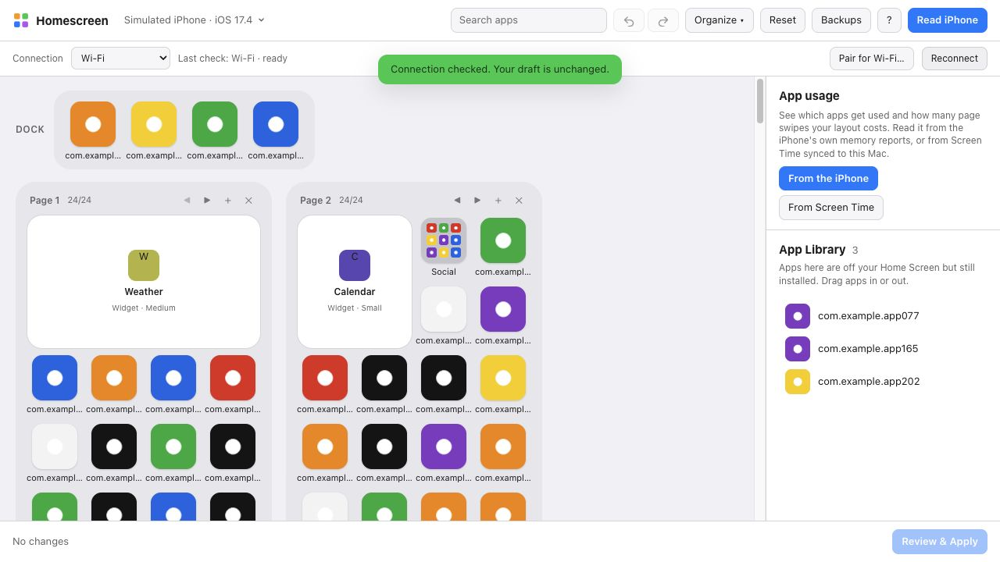
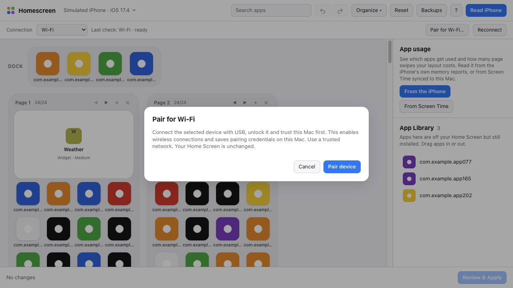

# Homescreen

**Arrange your iPhone or iPad Home Screen from your Mac.** Drag and drop with your real icons, sort by color or by how much you use each app, keep App Library apps where they belong, then apply the layout over USB or paired Wi-Fi. You can also let an AI assistant do the arranging through MCP.

Free and open source. Runs entirely on your Mac. No account, no server, no jailbreak.

<picture>
  <source media="(prefers-color-scheme: dark)" srcset="docs/app-dark.png">
  
</picture>

## Features

- **USB / Wi-Fi / Auto:** one-time trusted USB pairing for wireless access; Auto prefers USB for the selected device and never silently selects another phone.
- **Mac app**: one download, nothing to install. It finds connected iPhones and iPads, and keeps a separate draft and backups for each.
- **Drag-and-drop editor** on the device's real grid (4×6 on iPhone; iPads report their own, e.g. 5×6): real icons, widgets at their real sizes, folders (several pages each), the dock, and page add/move/delete.
- **Gaps (empty spaces).** Drop an app on any empty spot to place it exactly there. Homescreen writes the gap to the phone and remembers it, so it survives later edits.
- **Widgets keep their settings** (which script, which person, which city) through every apply.
- **App Library that stays put.** Apps you keep only in the App Library stay there when you apply, and you can drag apps into or out of it. Most tools get this wrong ([why](#why-other-tools-dump-app-library-apps-onto-your-home-screen)).
- **App Bank** to park apps, folders or widgets while you rearrange.
- **One-click organizing:**
  - by color
  - A–Z
  - by App Store category
  - **by how much you use each app**: moves your most-used apps onto the first pages, with an estimate of how many page swipes that saves. Usage comes from the device itself (no setup) or from Screen Time synced to your Mac
- **Undo/redo** for every change, multi-select, search, and swap (⌥-drop).
- **Safe apply:**
  1. Nothing reaches the phone until you review and apply.
  2. Your current layout is backed up first.
  3. The result is read back and verified.
  4. A failed write is never blindly retried.
  5. Any backup can be restored in one click.
- **AI assistant (MCP):** tools so Claude (or any MCP client) can read, rearrange, sort and explain your layout. Writing to the phone stays off unless you enable it.
- **CLI** for scripting: `homescreen read | show | diff | apply | backups | restore | probe | ui`, plus `devices | pair-wifi | connect | reconnect`.

## Requirements

- A Mac with Apple silicon and macOS 14 or later (the app). The Python package also runs on Intel Macs with Python 3.11+.
- A trusted USB iPhone/iPad, or a previously paired device on the same local network. Wi-Fi requires iOS/iPadOS 17+ and pymobiledevice3 11.50.0 or later (below 12). No root access, Developer Mode or Xcode wireless setup is needed.
- Existing USB/simulator validation (before this Wi-Fi change): tested with iOS 27.0.1 (iPhone 17 Pro Max), iOS 26.6.2 (iPhone 17 Pro), iPadOS 26.6.2 (iPad Air 13") and the iOS 27.2 simulator. Other versions may work; the safety checks will tell you if a write didn't land as planned.

## Install

**The app:** download `Homescreen-<version>.dmg` from [Releases](https://github.com/kats1123/homescreen-mcp/releases), open it and drag Homescreen to Applications.

The app isn't notarized by Apple (that needs a paid developer account), so the first time macOS will refuse to open it. Right-click Homescreen in Applications, choose **Open**, then **Open** again. Or, after the first try, go to System Settings › Privacy & Security and click **Open Anyway**. You only do this once.

**Or the Python package** (CLI, MCP server and the same editor in your browser):
```bash
pipx install git+https://github.com/kats1123/homescreen-mcp
homescreen ui
```

## Use it

1. Open Homescreen and plug in your iPhone or iPad. Unlock it and tap **Trust** if asked.
2. Pick the device at the top if several are connected, then click **Read**.
3. Rearrange.
4. Click **Review & Apply**.

Before a big rearrangement, **unhide any hidden Home Screen pages** on the phone (long-press the Home Screen, tap the page dots). iOS doesn't report which pages are hidden, so apps could otherwise end up on a page you can't see.

**App usage** has two sources:
- **From the device** (no setup): iOS writes a memory report now and then that lists the apps it's holding in memory. Over days and weeks that shows which apps you actually use. Apps that iOS keeps running for calls, or keeps in memory every day, are counted less, since being in memory doesn't mean you opened them. Nothing on the device is changed.
- **From Screen Time:** turn on *Settings › Screen Time › Share Across Devices* on the device and the Mac. Homescreen reads the synced history locally, which needs **Full Disk Access** for Homescreen (or the Terminal you run `homescreen` from) in System Settings › Privacy & Security.

## Wireless setup and connection options

1. Connect the intended iPhone or iPad over USB, unlock it and trust this Mac.
   If Trust is not offered, select the device in Finder and complete trust there.
2. Select the device in Homescreen, then choose **Pair for Wi-Fi…** and confirm.
   This enables wireless device connections and creates a RemotePairing record on
   this Mac; it does not change your Home Screen.
3. Unplug the cable. Keep both devices on the same trusted network and keep the
   device awake and unlocked. Choose **Wi-Fi**, then **Reconnect** or **Read**.
   Allow Local Network access if macOS asks.

| Mode | Behavior |
| --- | --- |
| USB (default) | Uses USB only; existing commands remain valid. |
| Wi-Fi | Uses a previously paired RemotePairing device, even if USB is plugged in. |
| Auto | Uses USB when the selected device is attached, otherwise Wi-Fi for that same UDID. USB trust failures are reported rather than hidden by fallback. |

Choose a device explicitly when several are available. Once selected (including
from a saved draft), disconnecting it never selects another physical device.
**Reconnect** only checks access and keeps the draft. **Read** explicitly replaces
that draft with the current device layout. Devices are rediscovered through
Bonjour each time, so an IP address change does not require another USB pairing.
The status shows the transport used by the last successful operation; connections
are released between operations rather than held continuously.

CLI examples (global options go before the command):

```bash
homescreen devices
homescreen --udid YOUR_UDID pair-wifi  # confirms before enabling wireless/pairing
homescreen --transport wifi --udid YOUR_UDID read
homescreen --transport auto --udid YOUR_UDID reconnect
homescreen --transport wifi --udid YOUR_UDID diff
homescreen --transport wifi --udid YOUR_UDID apply TOKEN  # existing confirmation
homescreen --transport wifi --udid YOUR_UDID backups
homescreen --transport wifi --udid YOUR_UDID restore BACKUP_NAME  # confirms
```

The same selection is available through `HOMESCREEN_TRANSPORT=usb|wifi|auto`
and `HOMESCREEN_UDID=YOUR_UDID` for the CLI, browser editor and MCP server.
Fixture/simulator sources still take precedence. Transport controls do not affect them.

### Interrupted writes and recovery

Before Apply or Restore, Homescreen checks the connected identity, saves a
uniquely named backup, then records a pending operation on disk. It sends the
layout **once** and reads back the same device on a fresh connection. It never
retries a write, automatically restores a backup, or applies after reconnecting.

If readback is unavailable, the outcome is **unknown**, even if sending seemed to
succeed. The backup name is returned and further writes are blocked across
restarts. Reconnect, **Read device**, and inspect the current Home Screen before
editing/applying again or explicitly restoring a backup. Reading replaces the
old draft. A successful readback that differs from the target reports the
mismatch and loads what actually landed; it does not automatically undo it.

Backups now include the originating device identity. Existing backups remain
usable in their original per-device backup directory. Don't copy legacy backups
between device directories: those older files have no embedded identity.
App/CLI/MCP reads and writes sharing a data directory cannot overlap.

### Troubleshooting and limits

- If discovery finds nothing, unlock the device, confirm both are on the same
  network, allow the app/Terminal Local Network access in macOS Settings, and
  refresh the device list. Guest/client-isolated networks and VPNs may block
  Bonjour or device connections. There is no manual-IP fallback in this version.
- A stale/missing RemotePairing record needs USB setup again. Pairing credentials
  stay in pymobiledevice3's own data folder (`~/.local/share/pymobiledevice3/`, or
  `~/.pymobiledevice3/` for older installations). Treat them like passwords; never
  upload or share them. Disabling wireless device connections in Finder or
  revoking this Mac's trust on the device stops access; uninstalling Homescreen
  alone does not revoke trust.
- Each operation has a 30-second connection/service deadline and bounded cleanup.
  Large icon/usage operations may need to be requested again. Discovery normally
  browses for 5 seconds. Only one userspace tunnel is used at a time per process.
- Wi-Fi uses SpringBoard/installation-proxy remote shims and the same layout,
  widget-ID, stack, folder, web-clip and App Library preservation paths as USB.
  It does not expose extra widget settings, phone-created gaps or hidden pages.
  Readback checks observable layout placement and App Library contents, not
  widget content or gaps that iOS does not export.
- **Hardware validation: one iPhone on iOS 27.2 (2026-11-06).** Trusted USB
  pairing, a Wi-Fi read with the cable unplugged, and Auto fallback to Wi-Fi
  succeeded. A dock-only Phone/Messages swap through the bundled MCP engine was
  backed up, applied once and verified, then the original backup was restored and
  verified. The restored layout, App Library and exported widget configuration
  fields matched the original; the user also confirmed the original dock and
  expected widget content/settings on the phone. Existing unapplied draft edits
  were preserved by using a separate test draft. This validates that small
  roundtrip on one device; iPad, stack settings, phone-created gaps, multi-device
  Auto switching and disconnects during real writes remain untested on hardware.
  Automated mocked/fixture tests cover transport policy, payload preservation,
  identity checks, interruptions, cancellation and the existing layout workflows.
- Rebuild the Mac app to include the new engine and Local Network/Bonjour
  declarations. Existing released DMGs do not contain this branch's changes.

Screenshots below use a **simulated iPhone**, fixture icons and mocked transports;
they demonstrate UI behavior, not a successful wireless hardware connection.




## Let an AI assistant arrange it

Add the MCP server to Claude Code. With the app, use **Device › Copy MCP Setup Command** and paste it in Terminal. It points at the engine inside the app:
```bash
claude mcp add homescreen -- /Applications/Homescreen.app/Contents/Resources/engine/engine mcp
```
With the Python package:
```bash
claude mcp add homescreen -- homescreen-mcp
```
or to Claude Desktop (`claude_desktop_config.json`):
```json
{ "mcpServers": { "homescreen": { "command": "homescreen-mcp" } } }
```
Then ask things like *"organize my apps by color"*, *"put the apps I use most on page 1"* or *"file my loose apps into folders that make sense"*.

The assistant edits a draft. You apply it in the app (`homescreen ui`, then Review & Apply) or with `homescreen apply <token>`. To let the assistant apply by itself, start the server with `HOMESCREEN_ALLOW_APPLY=1`.

For a wireless MCP session, set the transport/UDID in the server environment,
or call these tools before the existing read/edit/diff workflow:

```text
list_devices()
connect_device(transport="wifi", udid="YOUR_UDID")
read_phone()
# Existing show_layout / move / arrange / diff / render_preview tools are unchanged.
reconnect_device()  # no layout write; does not discard the draft
pair_wifi()         # only after explicitly approving USB-based wireless pairing
```

The existing `HOMESCREEN_ALLOW_APPLY=1` gate still controls both MCP `apply` and
`restore`. Wireless selection does not enable writes or bypass user authorization.

## Why other tools dump App Library apps onto your Home Screen

Found by reading SpringBoard's code in the iOS 27.2 simulator, then confirmed on a real iPhone:

1. Over USB, SpringBoard's `getIconState` only returns a **list**: `[dock, page 1, page 2, …]`. There's no App Library in it, in any `formatVersion`.
2. Writing that list back with `setIconState` reaches `-[SBIconController importIconState:]`. `+[SBIconStateArchiver rootArchiveFromITunesRepresentation:]` turns the list into `{buttonBar, iconLists}` and nothing else.
3. Every installed app the layout doesn't mention is then **put on a page**. Writing back an *unchanged* layout moved 33 App Library apps onto a phone's Home Screen.

**What Homescreen does instead:** SpringBoard's import also accepts its own on-disk dictionary form, which has the App Library as `ignored`. Homescreen sends:
- `buttonBar` and `iconLists`, with apps as bundle-id strings, folders with their contents, and widgets unchanged.
- `ignored`: the App Library. USB can't read it, so it's computed as installed apps (including offloaded ones), minus apps on the Home Screen, minus hidden and system-only apps.

**Widgets keep their settings.** A configured widget (which script, which person, which city) is linked to its settings by an element ID. Over USB that ID only appears as `userSelectedElementIdentifier`. Writing a widget without it as `uniqueIdentifier` makes SpringBoard save the widget with no ID, and its settings are orphaned. Homescreen sends it back, and remembers each widget's ID across reads in case iOS drops one. Verified on iOS 27.0.1: a configured Scriptable widget kept its script through a write.

**Web clips in the App Library.** Web clips aren't installed apps, so the installed-app list can't put them in `ignored`, and USB never reports them. A write that leaves one out makes iOS put it in the first free spot on a page. Homescreen remembers every web clip it has seen on each phone and sends it in `ignored`. If iOS surfaces one it has never reported, the apply result names it (`hidden_webclips`); move it to the App Library and apply again. Found on iOS 26.6.2.

Keys it leaves out (Today View, page IDs) keep their values on the phone. Any installed app that isn't listed anywhere goes to the App Library, never onto a page.

`tools/sbhelper/` contains the simulator harness used to work this out. It feeds layouts to the simulator's SpringBoard through the same import path a USB write takes.

## How it works

- **[pymobiledevice3](https://github.com/doronz88/pymobiledevice3)** talks to the phone over USB or a userspace RemotePairing Wi-Fi tunnel:
  - `com.apple.springboardservices` for the layout and icons
  - `installation_proxy` for the installed apps
  - `*.shim.remote` equivalents over Wi-Fi; shared transport selection lives in `homescreen/transport.py`
- **Nothing is rebuilt.** Each app, folder and widget keeps its original data, and edits only move it around. Unknown fields go back untouched.
- **Validation** runs before every apply:
  - page capacity: 24 slots; small/medium/large widgets take 4/8/16
  - dock of 4, and folders of 9 per page
  - no folders or widgets inside folders
  - no item lost or duplicated, and an empty App Bank
- **Screen Time** comes from the Biome `App.InFocus` streams macOS keeps for synced devices. Page swipes are estimated as page *N* costing *N−1* swipes, plus folder pages, with the dock free.
- **Local only.** The app listens on 127.0.0.1, and every change request needs a per-launch token. Device connections stay on USB/the local network. The optional internet call is *Group by App Store category*: it sends bundle IDs to Apple's public lookup API, asks first, and caches the results.

Data (drafts, backups, icon cache) lives in `~/Library/Application Support/homescreen-mcp`.

## Gaps and hidden pages: what iOS allows over USB

- **iOS stores gaps as pinned cells for each page** (`listMetadata` → `fixedLocations`), keyed by page ID.
- **Writing gaps works.** Homescreen sends page IDs plus the pins and verifies the result. Tested on iOS 27.0.1 and the iOS 27.2 simulator.
- **Reading them doesn't.** None of SpringBoard's USB exports (`getIconState` in any `formatVersion`) includes gaps or hidden pages. They only return the order of icons. And a write without them clears every gap, even on pages nobody touched.
- **What that means in practice:**
  - **Gaps set in Homescreen** are remembered for each phone and sent with every write, so they last.
  - **Gaps made on the iPhone itself** can't be seen, so they close on the first apply. Recreate them in Homescreen (drop the app on that spot); the Apply screen warns about this.
  - **Hidden pages** are likewise invisible over USB. Unhide them before applying.

## Limitations

- Hidden pages and gaps made on the phone itself can't be read (see above).
- **iPad support is new.** The grid, dock size and folder size come from the device (an iPad Air 13" reports 5×6, a 26-app dock and 16 per folder page), and arranging through MCP or the CLI works (tested on iPadOS 26.6.2). The editor draws the iPad's grid. iPad widget sizes don't map onto the icon grid like iPhone ones, so a widget page is only accepted when it keeps the shape iPadOS gave it.
- A few system apps that iOS never shows on the Home Screen are listed in `NEVER_ON_HOME_SCREEN` (`homescreen/device.py`). If a write reports one under `added_by_ios`, add it there.

## Development

Build the Mac app (Apple silicon, Xcode command-line tools) into `build/`:
```bash
macapp/build.sh
```
It bundles the engine with PyInstaller, compiles the Swift shell in `macapp/Shell`, ad-hoc signs the app and makes a DMG.

```bash
git clone https://github.com/kats1123/homescreen-mcp && cd homescreen-mcp
python3 -m venv .venv && .venv/bin/pip install -e '.[dev]'
.venv/bin/python -m pytest -q tests
```
- Without a phone: `HOMESCREEN_FIXTURE=<layout.plist> homescreen ui`. Build a test layout with `python tests/fake_phone.py fake.plist --dict`.
- On a booted simulator: `HOMESCREEN_SIM=booted homescreen ui`.

## Disclaimer

Not affiliated with, endorsed by or sponsored by Apple Inc. iPhone, iOS and Screen Time are trademarks of Apple Inc. This tool uses private device interfaces that can change with any iOS update. It backs up before every write and verifies after, but you use it at your own risk; keep your own iPhone backups too.

## License

MIT. See [LICENSE](LICENSE). Wireless design references and adapted MIT code are
credited in [THIRD_PARTY_NOTICES.md](THIRD_PARTY_NOTICES.md), including
[Rejig](https://github.com/rejig-app/rejig),
[ios-homescreen](https://github.com/YakupEmreYerli/ios-homescreen) and the existing
[pymobiledevice3](https://github.com/doronz88/pymobiledevice3) runtime dependency.
